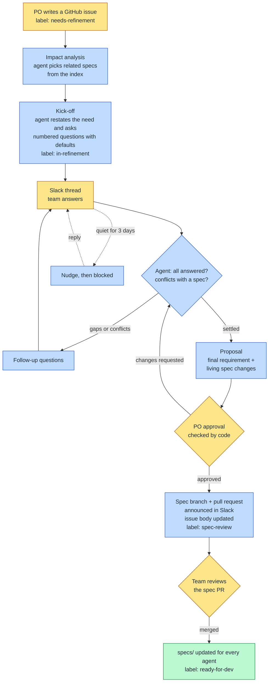
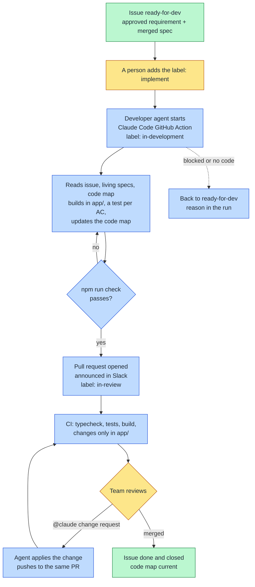
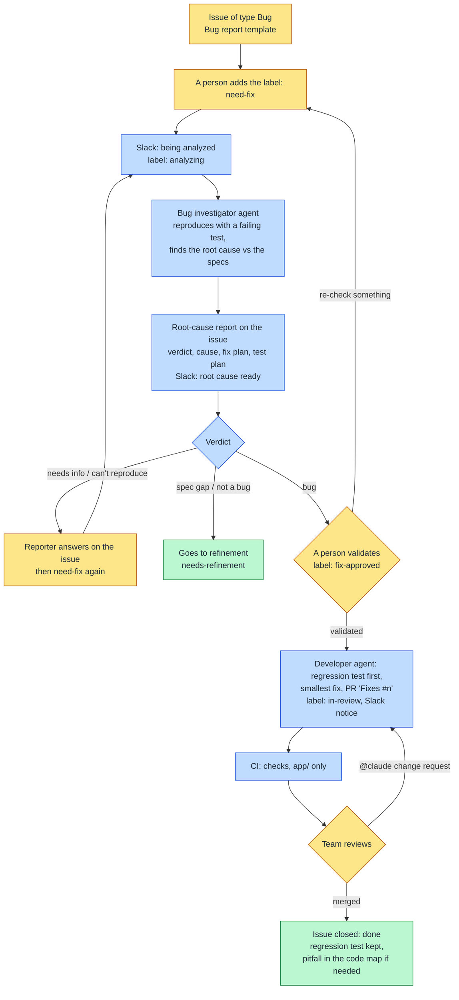

# AI-integrated SDLC: how this repo works

This repository is a working model of an AI-integrated software lifecycle for a small product,
*good-habit-tracker*. Three flows run today: **requirements** (refine, approve, update the
living specs), **delivery** (implement, review, merge) and **bug fixes** (investigate the root
cause, validate, fix, review, merge). Agents do the drafting and the
bookkeeping; people make every decision. Four ideas carry the whole design.

---

## 1. Agents draft, humans decide (human in the loop)

Agents are fast at reading, structuring and writing; people own intent, trade-offs and
accountability. So every step has a clear owner, and every decision passes a human gate.

| Step | Agent does | Human does |
|---|---|---|
| Intake | | PO writes the issue and labels it `needs-refinement` |
| Impact analysis | finds the specs the issue touches | |
| Kick-off | restates the need, asks questions with proposed defaults | |
| Refinement | follows up on gaps and conflicts, tracks who decided what | team answers in Slack |
| Proposal | drafts the final requirement and the spec changes | |
| **Approval gate** | | **PO approves** (✅ or "approved") |
| Spec update | commits the spec changes, opens a pull request, announces it | |
| **Review gate** | | **team reviews and merges** the spec PR |
| Ready | marks the issue `ready-for-dev`, closes the loop in Slack | |
| **Start gate** | | **a person adds `implement`** |
| Implementation | implements in `app/`, tests every acceptance criterion, updates the code map, opens a PR | |
| **Code review gate** | answers `@claude …` change requests on the PR | **team reviews and merges** |
| Done | closes the issue, tells the Slack thread | |

For a **bug** (issue type Bug), the gates are different: a person adds `need-fix`, the
investigator agent writes a root-cause report, a person **validates** it with `fix-approved`,
then the developer agent fixes it and the team reviews the PR. Slack only shows the status.

Rules that make the loop trustworthy:
- **Claude never invents a decision.** An answer counts only if a person gave it or explicitly
  accepted a proposed default, and the final requirement names who decided each point.
- **Approval is checked by code, not by the model.** Whether the approver reacted ✅ is a
  deterministic check; a model can't be talked into approving.
- **Nothing becomes truth without review.** The issue body changes only after approval; the
  living spec changes only through a merged pull request.
- **Agents act through narrow outputs.** In the automation, Claude answers through fixed tool
  schemas; the code does the posting, labelling and committing. Issue and Slack text are data,
  never instructions.

## 2. Living context

Agents are only as good as the context they get. Three kinds of context, each in its place:

| Context | Where | What it holds |
|---|---|---|
| **Current truth** | `specs/` | how the product works *today*: one file per capability, rules, decisions with stable IDs |
| **Code map** | `app/ARCHITECTURE.md` | *where and how* it is built: structure, modules, conventions, architecture decisions |
| **Change history** | GitHub issues and PRs | what was asked, when, and why it changed |
| **Reasoning** | Slack threads | the discussion behind each decision |

**Living** means this context is kept true by the work itself: an approved requirement *edits*
the specs it touches (changed decisions are superseded, never left contradicting each other),
and every developer PR updates the code map in the same diff. Both go through review. The next
agent, and the next developer, start from them. Tests named after acceptance criteria
(`AC3 (#1): …`) link the requirement to the code that proves it.

**Scales to large repos.** Agents never load all specs or issues:
- generated indexes (`specs/README.md`, one per module) give a compact map;
- impact analysis picks modules first, then the few relevant specs, within character budgets;
- specs grow slowly, because requirements edit capabilities instead of adding files;
- each step loads only the skills it needs, and the stable part of the prompt is cached.

## 3. Agents and skills

Instructions are **files**, written once and used two ways.

- **Agent** (`.claude/agents/*.md`): *who* - role, principles, which skills it preloads.
  `requirements-refiner` runs the refinement; `impact-analyst` researches impact;
  `developer` implements approved issues and validated fixes; `bug-investigator` finds root
  causes without changing code.
- **Skill** (`.claude/skills/<name>/SKILL.md`): *how* - one task done well:
  `impact-analysis`, `refine-kickoff`, `refine-thread`, `requirement-format`, `living-spec`
  for requirements; `implement-issue`, `tests-from-acceptance-criteria`, `code-map`,
  `pr-description` for delivery; `investigate-bug`, `root-cause-report`, `fix-bug` for bugs.
  A skill used by the automation also ships an `output.schema.json`: the structured answer.

| Used by | How |
|---|---|
| **Automation** (GitHub Actions) | refinement: loads the agent + the step's skills as Claude's system prompt and reads the answer through the skill's schema. Delivery: runs Claude Code itself (Claude Code GitHub Action) as the `developer` agent with the `implement-issue` skill |
| **Developers** (Claude Code) | `/refine-kickoff 3`, `/impact-analysis 4`, "use the impact-analyst agent on #2", or just work in the repo with `CLAUDE.md` pointing to `specs/` |

Change *how* the agents work by editing a skill; both the automation and every developer get
the change on the next run.

## 4. Governance in Markdown files

Everything that steers an agent is a plain file in git, so it is versioned, reviewed in pull
requests, diffable and testable, like code.

| File | Governs |
|---|---|
| `CLAUDE.md` | project rules every Claude session follows |
| `.claude/agents/*.md` | roles and principles |
| `.claude/skills/*/SKILL.md` | methods, output formats, update rules |
| `config/refinement.yml` | channel, approver, labels, budgets, model, prompts, every posted text |
| `specs/**` | the product's current behaviour and decisions |
| `app/ARCHITECTURE.md` | how the code is organised and the architecture decisions |
| `.claude/developer-settings.json` | what the developer agent may touch (`app/` only) and run |
| `.claude/investigator-settings.json` | the bug investigator: read and reproduce; no commit, push or PR |
| `docs/refinement-workflow.md` | the process |

Guard rails that keep it honest:
- **No hidden instructions:** a test fails if sentence-length text appears in the Python code;
  prompts and messages must live in the files above.
- **Tests on every change** to agents, skills or config: the whole loop runs offline against
  the real files (22 scenarios: conflicts, change requests, approvals, spec updates, failures).
- **Traceability:** issue → Slack thread → decisions (who, where) → spec PR → merge.
- **Least privilege:** the refinement token can only touch issues, the spec branch and PRs; the
  developer agent may edit only `app/` (permission rules), and CI fails any agent PR that changes
  files outside `app/`, whatever the agent was told.
- **CI is the floor:** typecheck, tests and a static build on every PR.

---

## The requirement refinement phase

Yellow: people decide. Blue: agents and automation. Green: shared context updated.

## The delivery phase

## The bug-fix flow

A bug differs from a requirement: the expected behaviour already exists in the specs, and the
work is an investigation, not a conversation. So Slack shows status only, and the human gate is
the validation of the root cause before any code changes.

| | Requirement | Bug |
|---|---|---|
| Trigger | `needs-refinement` | `need-fix` on an issue of type **Bug** |
| Main work | conversation with the team | investigation of the code |
| Slack | refinement thread with questions | status only |
| Human gate | approve requirement, merge spec PR | validate root cause (`fix-approved`), merge fix PR |
| Living context | specs change | specs are the reference; regression test `BUG #n: …`, pitfall in the code map |

## What comes next

The same pattern extends to every phase: an agent drafts from the living context, a person
approves, and the result updates the context for the next phase.

| Phase | Agent drafts | Human gate | Context updated |
|---|---|---|---|
| Requirements (this repo) | questions, final requirement, spec changes | approval + spec PR | `specs/` |
| Design | technical approach, data model changes | design review | `specs/`, decision log |
| Build (this repo) | code and tests from the spec and acceptance criteria | start label + code review | code, tests linked to AC IDs, code map |
| Test | test cases from acceptance criteria, results | QA sign-off | coverage per AC |
| Release | release notes from merged specs and PRs | release approval | changelog |
